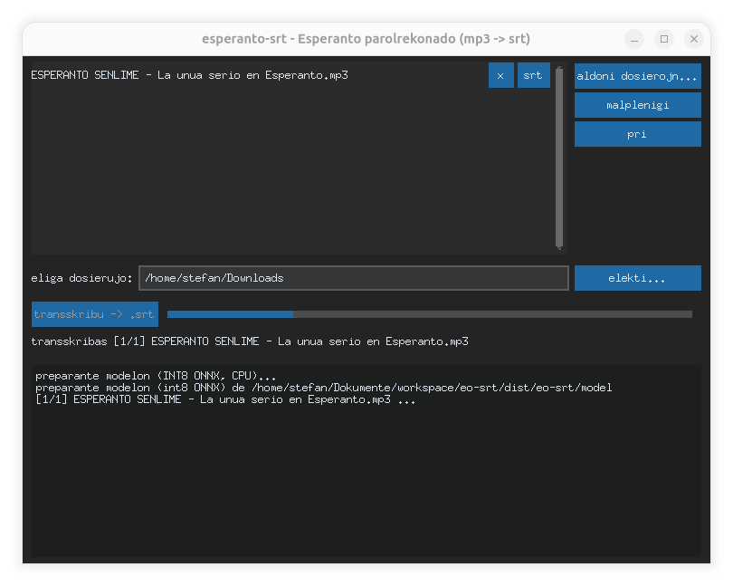
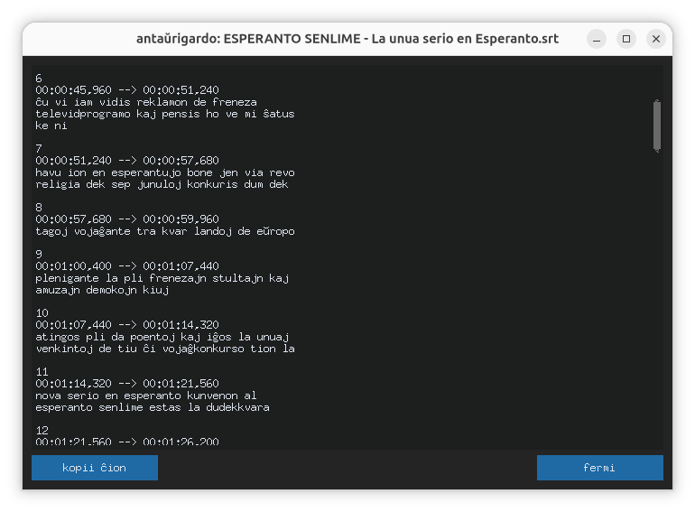

# esperanto-srt


Esperanto speech-to-text: turn mp3 audio into `.srt` subtitle files, with a small desktop GUI. Runs on **Linux and Windows**, CPU-only, fully offline.

Uses the INT8 ONNX export of NVIDIA's Esperanto Conformer-Transducer Large model ([OpenVoiceOS/nvidia-eo-conformer-transducer-large-onnx](https://huggingface.co/OpenVoiceOS/nvidia-eo-conformer-transducer-large-onnx), converted from `nvidia/stt_eo_conformer_transducer_large`, license CC-BY-4.0) via [onnx-asr](https://github.com/istupakov/onnx-asr) + ONNX Runtime. No PyTorch, NeMo or CUDA involved.

Special thanks to all the contributors of the [Esperanto Dataset of the Common Voice Project](https://commonvoice.mozilla.org/eo) that made this possible. 

## Screenshots




##  Downloads

| Artifact | Platform |
|---|---|
| [eo-srt-v0.3-linux.tar.gz](https://github.com/BitsAndDopamine/Esperanto-SRT/releases/download/v0.3/eo-srt-v0.3-linux.tar.gz) | Linux (x86_64) |
| [eo-srt-v0.3-windows.zip](https://github.com/BitsAndDopamine/Esperanto-SRT/releases/download/v0.3/eo-srt-v0.3-windows.zip) | Windows (x64) tested on Windows 11, often blocked by antivirus at first start |

At least 10 GB of RAM recommended.

## Install

Requires **Python 3.10+**.

```bash
python3 -m venv .venv
.venv/bin/pip install -e ".[test]"
python fetch_model.py        # downloads the INT8 model (~142 MB) into models/ (once)
```

On Windows use `.venv\Scripts\pip.exe …` and `python` instead of `python3`.

No ffmpeg needed: mp3/wav/ogg/flac decoding is handled by `soundfile` (libsndfile ≥ 1.1 reads mp3 directly).

## Run

GUI:

```bash
.venv/bin/python -m eo_srt
```

CLI:

```bash
.venv/bin/eo-srt-cli episode.mp3 more.mp3 -o subtitles/
```

Writes `episode.srt` next to each input (or into the `-o` directory). Accepted input formats: mp3, wav, ogg, flac (m4a/aac only when ffmpeg is installed). Both the GUI and the CLI show chunk-level progress, so long files don't look stuck.

The GUI is in **Esperanto** (with diacritics). After a run completes it opens a read-only **preview window** of the finished `.srt` with a "kopii ĉion" (copy all) button; each file in the list also has an "srt" button to preview its `.srt` — it is only clickable once the `.srt` exists (it lights up as soon as transcription of that file starts, since the file grows incrementally). A **"pri"** button opens a small window with the version, the GitHub repository and the licenses. The CLI stays ASCII-only (some Windows consoles can't print diacritics).

The `.srt` file is **written incrementally**: it is created when transcription starts and grows block by block while the progress bar runs, so you can already open it (in an editor, a player, or the preview window) and check the transcript so far. If a run fails midway, the partial file is kept.

On CPU, inference runs at roughly 10-15x realtime (a 48-minute podcast takes ~3-5 minutes).

## How it works

1. Audio is decoded and resampled to 16 kHz mono (`eo_srt/audio.py`, soundfile + a small numpy polyphase resampler).
2. Long files are transcribed in 30 s chunks with the INT8 ONNX model, 4 chunks per batched encoder call (`eo_srt/model.py`). Audio is passed to the recognizer as numpy arrays (in-process, no worker processes).
3. The transcript is split into timed subtitle blocks and written as srt (`eo_srt/srt.py`, `eo_srt/transcribe.py`) — incrementally, so the `.srt` exists and grows while the progress bar runs.

Note: the model outputs **lowercase text without punctuation** — the srt text is passed through as-is.

## Portable builds (standalone executable)

Build a self-contained app with PyInstaller — no Python needed on the target machine:

```bash
.venv/bin/python build.py          # -> dist/eo-srt/ (folder, ~250-350 MB)
```

- The executable inside is **named with the version**: `eo-srt-v1.0-linux` (Linux) / `eo-srt-v1.0.exe` (Windows). The version comes from `eo_srt/__init__.py` (`__version__`, the single source — `pyproject.toml` reads it from there, the "pri" window shows it, and the executable is named after it); override it with `build.py --version v1.0.1`. On Linux the name ends in `-linux`, **not** in a digit: a name like `eo-srt-v1.1` ends in `.1`, which Linux's shared MIME database classifies as a man page (`*.1`–`*.9` glob) — a text file — so file managers would open the binary in a text editor on double-click instead of running it.
- The executable with **no arguments opens the GUI**; with arguments it works as the CLI: `eo-srt-v1.0-linux fremdulo.mp3 -o out/`.
- PyInstaller **cannot cross-compile** — build once per OS. CI builds Linux (`tar.gz`) and Windows (`zip`) artifacts on every `v*` tag and attaches them to a GitHub release (`.github/workflows/build.yml`). To cut a release: **bump `__version__` in `eo_srt/__init__.py` first** (it is the single source — the "pri" window, the executable name and the archive names all follow it), commit, then tag and push: `git tag v1.0 && git push origin master v1.0`. CI fails the build when the tag and `__version__` disagree, so the versions can never drift apart.
- The release archives contain the bundle's files **directly** — the versioned executable, `_internal/` and `model/` sit at the archive root; there is no top-level folder to open after extracting.
- The bundle is **CPU-only ONNX Runtime** (no CUDA); inference is ~10-15x realtime on a CPU.
- The INT8 model (~142 MB) **is bundled** in `dist/eo-srt/model/`, beside the executable. Nothing is downloaded at runtime — the app works fully offline, including on a fresh Windows machine without Python.
- The app icon (`eo-srt.png`) is **embedded in the Windows executable** and shown in the **window/taskbar** on every OS (on Linux the taskbar/dock reads it from the running window).
- The model files are fetched at build time by `fetch_model.py` (pinned Hugging Face commit, sha256-verified) into `models/` (gitignored; never committed — the encoder file is too large for git).
- Point the app at a different model directory with the `EO_SRT_MODEL_DIR` environment variable (or `--model MODEL_DIR` on the CLI).

### Building the Windows executable (step by step)

PyInstaller cannot cross-compile, so the Windows build runs **on a Windows machine**. You need internet **once** (for pip and the model download); the finished app is fully offline.

1. **Install Python 3.12** from https://www.python.org/downloads/ (3.10–3.14 all work; CI uses 3.12). In the installer, tick **"Add python.exe to PATH"**.
2. **Copy the repo** to the Windows machine (e.g. `C:\eo-srt`) and open **PowerShell** (or cmd) in that folder.
3. **Create a build venv and install the dependencies** (PyInstaller + the CPU-only ONNX stack — no torch/NeMo/CUDA):

   ```powershell
   python -m venv .venv
   .venv\Scripts\python.exe -m pip install -e ".[build]"
   ```

4. **Download the model** (~142 MB, one-time, sha256-verified):

   ```powershell
   .venv\Scripts\python.exe fetch_model.py
   ```

   Offline alternative: copy the `models\` folder from a previous build (e.g. from the Linux machine) into the repo — `build.py` reuses it when the checksums match.
5. **Build**:

   ```powershell
   .venv\Scripts\python.exe build.py
   ```

   Result: `dist\eo-srt\` (~300 MB) containing `eo-srt-v1.0.exe`, the `_internal\` runtime folder, and the model in `dist\eo-srt\model\`. A build takes a couple of minutes plus the model download.
6. **Test on a clean machine**: copy the `dist\eo-srt` folder to a PC without Python. Double-click `eo-srt-v1.0.exe` for the GUI, or run `eo-srt-v1.0.exe episode.mp3 -o out\` for the CLI. No internet needed.
7. **Distribute**: zip the folder's *contents* (PowerShell), so the zip has no top-level folder:

   ```powershell
   Compress-Archive -Path dist\eo-srt\* -DestinationPath dist\eo-srt-v1.0-windows.zip
   ```

   The zip is ~160 MB and contains `eo-srt-v1.0.exe`, `_internal\` and `model\` directly at its root.

Notes:

- No admin rights, GPU or CUDA needed — the build and the app are CPU-only.
- Windows Defender sometimes flags PyInstaller-built executables as a false positive; add an exclusion for the build folder if the exe gets quarantined.
- `.venv\` and `models\` are only needed for building and can be deleted afterwards — `dist\eo-srt\` is self-contained.
- The exe is built with a console window (it serves both the GUI and the CLI); double-clicking it opens the GUI plus a console window. This matches previous releases.
- The bundle must not contain `ucrtbase.dll`: Windows 10/11 provide the UCRT as part of the OS, and a bundled copy makes the exe fail at startup ("Failed to load Python DLL"). `build.py` filters it out automatically.

## Development

```bash
.venv/bin/python -m pytest
```

The model files (~142 MB) are downloaded by `fetch_model.py` into `models/` (gitignored) and are never committed.

## License

The code is dedicated to the public domain under [CC0 1.0 Universal](LICENSE). The bundled ASR model is NVIDIA's Esperanto Conformer-Transducer Large via [OpenVoiceOS/nvidia-eo-conformer-transducer-large-onnx](https://huggingface.co/OpenVoiceOS/nvidia-eo-conformer-transducer-large-onnx), license **CC-BY-4.0** — keep its attribution notice when redistributing the app.
